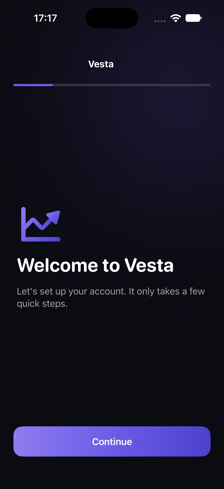
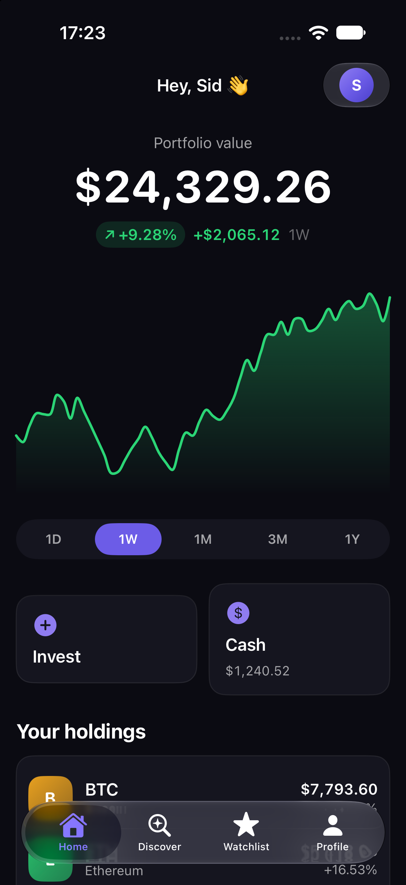
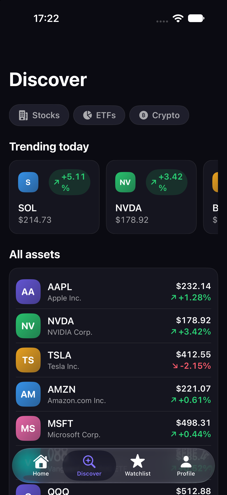
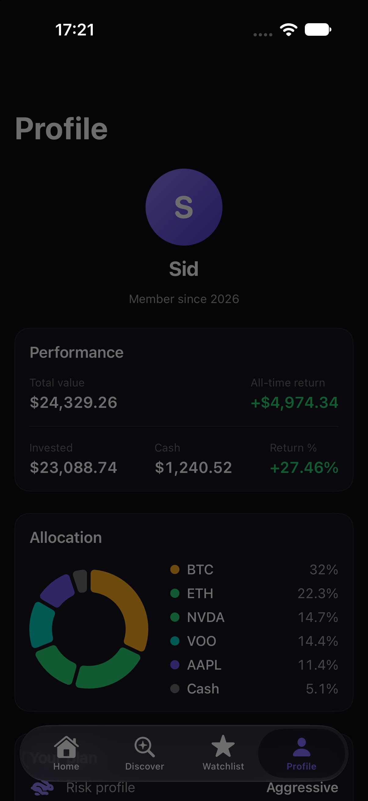
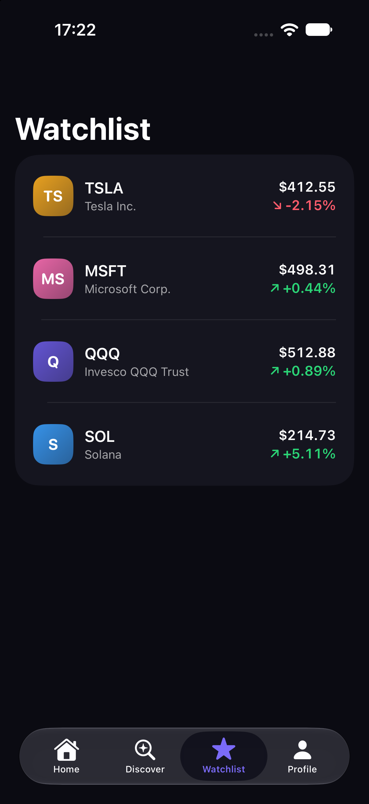

# Vesta

A small investing app I built with SwiftUI to practice iOS development.
You can go through onboarding, browse stocks/ETFs/crypto, view price charts,
buy and sell with fake money, keep a watchlist, and see your portfolio
allocation. All data is mock data, so it runs offline and nothing is real.

## Demo

<video src="https://github.com/sidshas03/Vesta/raw/main/media/demo.mp4" controls width="320"></video>

If the video does not play above, [download/view it here](media/demo.mp4).

## Screenshots

| Onboarding | Home | Discover |
| --- | --- | --- |
|  |  |  |

| Profile | Watchlist |
| --- | --- |
|  |  |

## Screens

- Onboarding (name, goals, risk level, monthly contribution)
- Home: portfolio value, chart with a draggable scrubber, and holdings
- Discover: search + category filters + trending
- Asset detail: chart, your position, stats, and a buy/sell sheet
- Watchlist: swipe to remove
- Profile: performance, allocation donut, plan summary

## Project layout

```
Vesta/
  App/            app entry, shared AppModel, root navigation
  DesignSystem/   colors, components, formatters, haptics
  Models/         Asset, Holding, Portfolio, etc.
  Services/       MarketDataService protocol + mock implementation
  Features/       one folder per screen (view + view model)
```

I used MVVM with a view model per screen, the `@Observable` macro for state,
and async/await in the data layer. The views talk to a `MarketDataService`
protocol instead of a concrete type, so the mock could be swapped for a real
API later.

## Requirements

- Xcode 16+ (iOS 17 SDK)
- An iOS 17 simulator or device

## Running

```bash
open Vesta.xcodeproj
```

Pick an iPhone simulator and press Run (Cmd+R).

## Testing the logic

The money math and chart data generation are plain Swift with no UI, so they
can be compiled and run on their own:

```bash
mkdir -p /tmp/vesta_logic_check && cd /tmp/vesta_logic_check
cp "$OLDPWD"/Vesta/Models/Models.swift \
   "$OLDPWD"/Vesta/DesignSystem/Formatters.swift \
   "$OLDPWD"/Vesta/Services/MarketDataService.swift \
   "$OLDPWD"/Vesta/Services/MockData.swift .
# add a main.swift with your checks
swiftc -O *.swift -o logic_check && ./logic_check
```

## Notes

- Data is simulated. No real accounts, prices, or trades.
